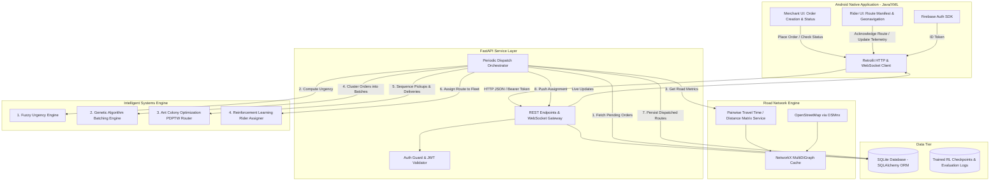

# MicroFleet — System Architecture & Technical Specification

## 1. System Overview

MicroFleet is an end-to-end multi-tiered software architecture designed for shared, collaborative urban delivery logistics. The platform aggregates delivery requests across independent local merchants, groups orders into optimal capacity-constrained bundles, solves exact multi-stop pickup-and-delivery routes, and assigns available mobile riders adaptively.



---

## 2. Subsystem Architecture

### 2.1 Android Client Subsystem
- **Runtime & Tooling**: Native Android with Java 8+, XML layouts, and ViewBinding.
- **Root Location**: The repository root directly hosts the Android project structure (`app/`, `build.gradle.kts`, `settings.gradle.kts`, `gradlew.bat`).
- **Core Modules & Layers**:
  - `ui/merchant`: Order entry form (pickup window, recipient address, item volume/weight, delivery deadline, customer priority tier).
  - `ui/rider`: Real-time order queue, stop-by-stop interactive delivery checklist, interactive route polyline display, order acceptance and delivery confirmation dialogs.
  - `ui/auth`: Login and registration backed by Firebase Authentication (Email/Password & Google Sign-In).
  - `network`: Retrofit 2 client with OkHttp interceptor injecting Firebase Bearer tokens, connecting to the FastAPI backend.
  - `data/local`: Local SQLite SQLiteOpenHelper / Room database for offline order caching and trip history.

### 2.2 FastAPI Backend Subsystem
- **Runtime**: Python 3.12+ asynchronous service managed with Uvicorn.
- **Directory**: `backend/app/`
- **Core Components**:
  - `app/api/`: REST endpoints segmented by domain (`merchants.py`, `orders.py`, `riders.py`, `dispatch.py`, `analytics.py`).
  - `app/core/`: Configuration via Pydantic `BaseSettings` (`config.py`), CORS middleware, error handlers, and security helpers.
  - `app/models/`: SQLAlchemy ORM database models mapping relational entities.
  - `app/schemas/`: Pydantic v2 schemas for strict request/response data contracts and serialization.
  - `app/services/`: Core business operations and the dispatch orchestrator.
  - `app/intelligence/`: The 4 computational intelligence engines.

### 2.3 Persistence & Relational Schema (SQLite)
The application utilizes SQLite for zero-setup local development, encapsulated via SQLAlchemy:
- **`merchants`**: `id`, `name`, `address`, `lat`, `lon`, `prep_time_avg_min`, `contact_phone`.
- **`riders`**: `id`, `name`, `phone`, `current_lat`, `current_lon`, `capacity_kg`, `capacity_vol_m3`, `status` (`IDLE`, `EN_ROUTE`, `OFF_DUTY`), `shift_remaining_min`, `battery_pct`.
- **`orders`**: `id`, `merchant_id`, `recipient_name`, `recipient_lat`, `recipient_lon`, `weight_kg`, `volume_m3`, `created_at`, `promised_deadline`, `ready_at`, `status` (`PENDING`, `BATCHED`, `DISPATCHED`, `DELIVERED`, `CANCELLED`), `urgency_score`.
- **`batches`**: `id`, `created_at`, `total_weight_kg`, `total_volume_m3`, `status`.
- **`routes`**: `id`, `batch_id`, `rider_id`, `total_distance_m`, `estimated_duration_s`, `status` (`ASSIGNED`, `IN_PROGRESS`, `COMPLETED`).
- **`waypoints`**: `id`, `route_id`, `sequence_index`, `type` (`PICKUP`, `DELIVERY`), `order_id`, `lat`, `lon`, `estimated_arrival`, `completed_at`.

### 2.4 Geospatial & Road Network Subsystem (OSMnx)
- **Data Source**: OpenStreetMap (OSM) extract representing a target operational region (e.g., central commercial district).
- **Processing**:
  - Downloaded via OSMnx bounding box / place query and cleaned (dead-ends preserved, simplified topology).
  - Serialized to `backend/data/networks/city_drive_network.graphml`.
  - In-memory representation using `networkx.MultiDiGraph`.
- **Distance & Travel Time Matrix Engine**:
  - Fast nearest-node mapping via KD-Tree / BallTree for geographic coordinates $(lat, lon)$.
  - Point-to-point shortest paths computed with edge weights incorporating road speed limits and physical lengths.
  - Matrix caching layer (`services/geo_service.py`) returning $N \times N$ travel time arrays for active coordinates.

---

## 3. Intelligent Systems Engine (Four-Pillar Synergy)

MicroFleet coordinates four computational intelligence paradigms into a sequenced pipeline:

```mermaid
sequenceDiagram
    autonumber
    participant D as Dispatch Orchestrator
    participant F as 1. Fuzzy Urgency Engine
    participant G as 2. Genetic Algorithm Batching
    participant A as 3. ACO Route Optimizer
    participant R as 4. RL Rider Assigner
    participant DB as SQLite Database

    D->>DB: Query active orders with status = PENDING
    DB-->>D: Return Order List [O1, O2, ..., On]
    
    rect rgb(240, 248, 255)
        Note over D,F: Pillar 1: Urgency Prioritization
        D->>F: Evaluate (Time to Deadline, Value, Kitchen Delay)
        F-->>D: Return Urgency Scores U_i in [0, 100]
    end

    rect rgb(245, 255, 250)
        Note over D,G: Pillar 2: Multi-Merchant Batching
        D->>G: Solve clusters (Orders, Dist Matrix, Vehicle Capacities)
        G-->>D: Return Batches [B1, B2, ..., Bm]
    end

    rect rgb(255, 250, 240)
        Note over D,A: Pillar 3: PDPTW Trajectory Synthesis
        loop For each batch B_k
            D->>A: Optimize Tour (Pickups + Deliveries + Time Windows)
            A-->>D: Return Ordered Waypoints & Metrics
        end
    end

    rect rgb(255, 240, 245)
        Note over D,R: Pillar 4: Adaptive Fleet Assignment
        D->>R: Match State (Available Riders, Generated Routes)
        R-->>D: Return Policy Action (Rider-to-Route Pairs)
    end

    D->>DB: Persist Batches, Routes, Waypoints; Update Order & Rider States
```

### 3.1 Pillar 1: Fuzzy Logic Urgency Engine
- **Responsibility**: Determine which orders demand immediate dispatch vs. those that can be held for consolidation.
- **Input Linguistic Variables**:
  - *Time to Deadline* ($T$): `{CRITICAL, TIGHT, COMFORTABLE, AMPLE}`
  - *Merchant Prep State* ($P$): `{DELAYED, READY_SOON, COMPLETED}`
  - *Order Importance / SLA Tier* ($V$): `{STANDARD, PREMIUM, VIP}`
- **Inference**: Mamdani min-max fuzzy inference with rule base balancing urgency against consolidation opportunities.
- **Defuzzification**: Center of Gravity (Centroid) yielding a crisp priority metric $\in [0, 100]$.

### 3.2 Pillar 2: Genetic Algorithm for Multi-Merchant Batching
- **Responsibility**: Partition $N$ active urgent orders into $M$ delivery bundles without exceeding vehicle weight/volume capacities while minimizing pickup fragmentation across merchants.
- **Chromosome Representation**: Direct grouping encoding or random key representation assigning order indices to batch identifiers.
- **Fitness Function**:
  $$F(C) = w_1 \cdot \text{CapacityUtilization}(C) - w_2 \cdot \text{SpatialDispersion}(C) - w_3 \cdot \text{MerchantSplits}(C) + w_4 \cdot \overline{\text{Urgency}}(C)$$
- **Genetic Operators**:
  - Tournament selection.
  - Order-preserving uniform crossover.
  - Swap, split, and merge mutations.
  - Elitist replacement preserving top candidates.

### 3.3 Pillar 3: Ant Colony Optimization for PDPTW Routing
- **Responsibility**: For each order batch, synthesize the optimal sequence of stops starting from merchant pickup locations to customer drop-off points.
- **Constraints Enforced**:
  - Precedence: Pickup node $P_i$ must be visited before Delivery node $D_i$.
  - Time Windows: Arrival at stop $j$ must satisfy $[e_j, l_j]$.
  - Capacity: Cumulative payload onboard at any step must not exceed $Q_{\text{max}}$.
- **Algorithm Mechanics**:
  - Artificial ants construct candidate tours probabilistically based on pheromone concentration $\tau_{ij}$ and heuristic visibility $\eta_{ij} = \frac{1}{d_{ij}}$.
  - Pheromone update with evaporation ($\rho$) and reward proportional to tour efficiency ($1 / L_k$).
  - Post-construction 2-opt local search respecting precedence constraints.

### 3.4 Pillar 4: Reinforcement Learning for Adaptive Rider Assignment
- **Responsibility**: Assign routed batches to riders in real-time under uncertain conditions (battery levels, traffic shifts, rider acceptance delay).
- **Formulation**: Markov Decision Process (MDP) $(\mathcal{S}, \mathcal{A}, \mathcal{P}, \mathcal{R}, \gamma)$:
  - **State $\mathcal{S}$**: Feature vector encoding rider locations, capacities, shift times remaining, and batch characteristics (estimated duration, route length, urgency sum).
  - **Action $\mathcal{A}$**: Matching decision index assigning route $k$ to rider $r$ or deferring assignment to next decision epoch.
  - **Reward $\mathcal{R}$**:
    $$\mathcal{R} = +R_{\text{delivered}} - \alpha \cdot \text{TotalDelay} - \beta \cdot \text{DeadheadDistance} - \lambda \cdot \text{IdleFleetPenalty}$$
  - **Algorithm**: Deep Q-Network (DQN) with experience replay and target network, or Proximal Policy Optimization (PPO).

---

## 4. End-to-End Operational Lifecycle

1. **Order Ingestion**: Merchant enters an order via Android app $\rightarrow$ sent via POST `/api/v1/orders` $\rightarrow$ stored in SQLite as `PENDING`.
2. **Periodic Dispatch Window**:
   - Backend dispatch loop awakens (e.g., every 60 seconds).
   - Fetches pending orders and computes Urgency Score via Fuzzy Engine.
   - Filters orders exceeding minimum urgency or consolidation thresholds.
3. **Batch Formation**: Filtered orders passed to Genetic Algorithm batcher $\rightarrow$ outputs balanced batches.
4. **Trajectory Optimization**: For each batch, ACO computes minimal-distance, precedence-compliant route waypoints using the cached OSMnx graph.
5. **Rider Matching**: The RL Agent inspects active riders in the vicinity and assigns each route to the best rider.
6. **Delivery Execution**:
   - Rider receives notification and opens route in Android app.
   - Rider navigates to merchant waypoints (marks "Picked Up"), then customer waypoints (marks "Delivered").
   - Updates stream back to backend via REST/WebSocket, updating order status and training logs.
