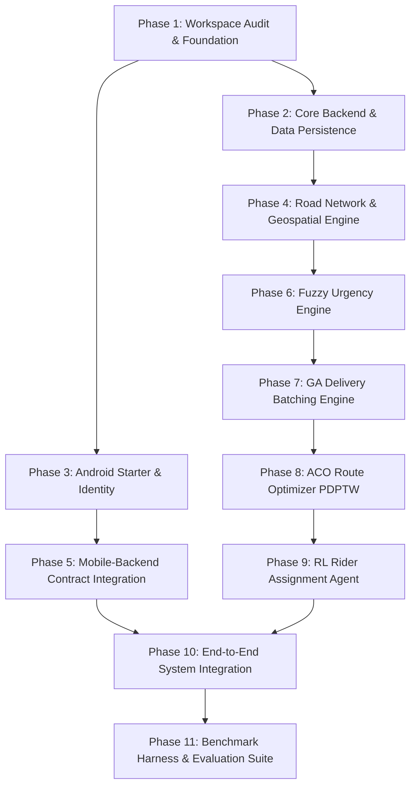

# MicroFleet — Project Plan & Engineering Roadmap

## 1. Executive Summary & Vision

**MicroFleet** is an Intelligent Shared Last-Mile Logistics platform engineered for urban clusters and local merchant cooperatives. Unlike conventional single-merchant or siloed delivery operations, MicroFleet aggregates parcel demand across multiple local businesses, applying computational intelligence to consolidate pickups, batch orders, optimize multimodal road routes, and assign riders dynamically.

The system delivers a fully integrated, measurable platform comprising:
- **Client Application**: Native Android application (Java & XML) supporting Merchant Order Management, Driver Dispatch & Delivery Tracking.
- **Backend Infrastructure**: Python & FastAPI asynchronous REST/WebSocket service with SQLite persistence for rapid local development.
- **Authentication**: Firebase Authentication for secure identity management across Merchants, Drivers, and Fleet Dispatchers.
- **Geospatial Intelligence Engine**: OpenStreetMap (OSM) via OSMnx for real-world road graph extraction, topology-aware distance/time matrices, and routing.
- **Multi-Paradigm Intelligence Suite**:
  1. **Fuzzy Logic**: Dynamic order urgency prioritization under delivery SLA and kitchen/prep uncertainty.
  2. **Genetic Algorithm (GA)**: Multi-merchant capacity-constrained order clustering and batch formation.
  3. **Ant Colony Optimization (ACO)**: Pickup-and-Delivery Problem with Time Windows (PDPTW) route synthesis.
  4. **Reinforcement Learning (RL)**: Adaptive Markov Decision Process (MDP) rider-to-route assignment under dynamic traffic, cancellation, and fleet availability.

---

## 2. Project Scope & Boundary Conditions

### 2.1 In Scope
- Modular, decoupled architecture separating mobile frontend, API gateway, geospatial layer, and AI solvers.
- Native Android UI with role-based workflows (Merchant, Rider, Admin/Dispatcher).
- SQLite-backed relational schema with clean migration paths.
- Standalone execution and benchmark harnesses for all 4 AI algorithms against standard heuristic baselines (FCFS, Greedy Nearest-Neighbor, Static Hungarian matching).
- Reproducible synthetic and public benchmark validation datasets.
- Realistic road network graphs fetched and cached locally via OSMnx for selected urban bounding boxes.

### 2.2 Out of Scope
- Commercial payment gateway integrations (transactions are recorded as test orders or cash-on-delivery).
- Proprietary closed-source map provider APIs (e.g., Google Maps paid Directions Matrix API) in the algorithmic loop; OpenStreetMap/OSMnx is strictly prioritized for reproducible, cost-free network queries.
- Cloud Kubernetes deployment orchestration in local development phases.

---

## 3. Phased Implementation Roadmap

### Phase 1: Workspace Audit & Foundation (Current Phase)
- **Objective**: Establish repo structure, evaluate development toolchain (JDK, Python, Android SDK, Gradle), establish `.gitignore` hygiene, and define core architectural specifications.
- **Deliverables**:
  - Validated toolchain report.
  - Complete repository layout (`backend/`, `docs/`, `backend/data/`, etc.).
  - `docs/PROJECT_PLAN.md`, `docs/ARCHITECTURE.md`, `docs/DATA_PLAN.md`.
- **Completion Criteria**: Tooling verified, directories scaffolded, architecture approved, no unversioned secret leakage.

### Phase 2: Core Backend Architecture & Local Persistence
- **Objective**: Implement FastAPI application core, SQLAlchemy / SQLite database layer, data transfer schemas (Pydantic v2), and RESTful CRUD endpoints.
- **Deliverables**:
  - `backend/app/main.py`, config settings, logging.
  - Database models: `Merchants`, `Orders`, `Riders`, `Batches`, `Routes`, `Deliveries`.
  - CRUD routers for order creation, merchant registration, rider telemetry updates.
  - Automated tests validating endpoints with `pytest`.
- **Completion Criteria**: Backend server starts cleanly on local port, passes all unit tests, creates SQLite tables automatically, and validates payloads.

### Phase 3: Android Studio Client & Identity Setup
- **Objective**: Establish the root Android Studio project with Java and XML layouts, Firebase Auth client, and HTTP networking via Retrofit.
- **Deliverables**:
  - Working root Android project (`app/`) compiling via `gradlew.bat assembleDebug`.
  - Role-based UI flows: Merchant view (place order), Rider view (view assigned batch/route, toggle delivery status).
  - Retrofit HTTP client interacting with the FastAPI backend.
- **Completion Criteria**: Clean Android build with zero compilation errors, functional views, and successful connection to backend mock endpoints.

### Phase 4: Road Network Graph & Geospatial Engine (OSM/OSMnx)
- **Objective**: Construct road-network graph ingestion, topology simplification, node-to-coordinate snapping, and travel time matrix caching.
- **Deliverables**:
  - Script to extract bounding-box road network graphs (e.g., Pune / Mumbai city sector or synthetic grid).
  - Serialization to GraphML in `backend/data/networks/`.
  - Fast shortest-path (Dijkstra/A*) travel time and distance matrix calculation service.
- **Completion Criteria**: Sub-50ms pairwise travel time lookup between any two urban coordinates on the cached graph.

### Phase 5: Intelligent Engine 1 — Fuzzy Urgency Scoring
- **Objective**: Quantify order dispatch priority under non-linear, multi-variable uncertainty.
- **Deliverables**:
  - Fuzzy membership functions for inputs: *Time to SLA Expiry* (Minutes remaining), *Order Value / Priority*, *Merchant Kitchen Prep Delay*.
  - Rule base mapping inputs to crisp output: *Urgency Score* $\in [0, 100]$.
  - Scikit-fuzzy or custom lightweight fuzzy inference engine without external black-box bloat.
- **Completion Criteria**: High priority assigned to orders nearing SLA threshold or vulnerable to kitchen delays; reproducible unit test testbed verifying rule activations.

### Phase 6: Intelligent Engine 2 — Genetic Algorithm for Batching
- **Objective**: Partition active, urgent orders from multiple merchants into feasible, compact clusters.
- **Deliverables**:
  - Chromosome representation: Multi-merchant order-to-batch partition vector.
  - Fitness function: Minimizing spatial dispersion and merchant pickup overhead while maximizing vehicle capacity utilization and urgency score aggregation.
  - Genetic operators: Order-safe crossover (PMX / Order Crossover), swap/inversion mutations, elitism.
- **Completion Criteria**: GA reduces total deadhead travel distance by $\ge 20\%$ compared to First-Come-First-Served (FCFS) batching on benchmark order sets.

### Phase 7: Intelligent Engine 3 — Ant Colony Optimization for PDPTW
- **Objective**: Solve the exact sequence of merchant pickups and customer deliveries for each formed batch.
- **Deliverables**:
  - Graph representation enforcing precedence (Pickup $P_i$ must precede Delivery $D_i$) and vehicle capacity constraints ($q(t) \le Q_{\text{max}}$).
  - Pheromone update rules and heuristic desirability ($\eta_{ij} = 1 / (\text{travel\_time}_{ij} + \epsilon)$).
  - Local search 2-opt heuristic for solution refinement.
- **Completion Criteria**: Produces 100% valid precedence-compliant routes with minimal time-window violations on benchmark PDPTW instances.

### Phase 8: Intelligent Engine 4 — Reinforcement Learning Rider Assignment
- **Objective**: Dynamically assign optimized routes/batches to mobile fleet riders considering real-time rider state, battery/fuel, shift constraints, and cancellation risk.
- **Deliverables**:
  - Gym-compatible environment `MicroFleetEnv`:
    - **State**: Available riders (locations, capacity, shift time remaining), Pending batches (urgency, estimated completion time, value).
    - **Action**: Matching matrix / assignment of batch to rider or deferral.
    - **Reward**: Net delivery utility bonus minus lateness penalties and idle wait times.
  - Agent implementation: DQN / PPO or Contextual Bandit with stable reward convergence.
- **Completion Criteria**: RL assignment achieves superior cumulative reward and lower delivery delay variance compared to greedy nearest-rider heuristics.

### Phase 9: End-to-End Orchestration & Android Live Dispatch
- **Objective**: Wire all 4 intelligence layers into an automated, periodic dispatch pipeline triggered by backend background workers.
- **Deliverables**:
  - Periodic dispatch runner: `Trigger -> Fuzzy Urgency -> GA Batching -> ACO Routing -> RL Assignment -> Rider Push Notification`.
  - WebSocket / polling stream delivering live route polyline coordinates and delivery checklists to Android devices.
- **Completion Criteria**: An order placed on the Android app passes through the complete pipeline, appears as a route on the rider's Android screen, and updates status in real-time.

### Phase 10: Empirical Evaluation, Benchmarking & Technical Reports
- **Objective**: Validate algorithmic superiority with quantifiable metrics against classical baselines and standard VRP benchmark datasets (e.g., Li & Lim PDPTW).
- **Deliverables**:
  - Automated benchmark runner `backend/scripts/run_benchmarks.py`.
  - Metrics collected: Total travel distance (km), average delivery delay (min), rider utilization rate (%), algorithm execution time (ms).
  - Auto-generated Markdown and CSV reports in `backend/reports/`.
- **Completion Criteria**: Verified, reproducible performance tables proving efficiency gains across multiple fleet scale scenarios (10, 50, 200 orders).

---

## 4. Quality & Verification Gates

| Gate | Phase | Verification Method | Pass Condition |
| :--- | :--- | :--- | :--- |
| **G1: Toolchain & Repo Hygiene** | Phase 1 | Direct CLI audit & git status | Clean tree, no secrets, valid directories |
| **G2: Backend Unit Tests** | Phase 2 | `pytest backend/tests/` | 100% pass rate, SQLite CRUD functional |
| **G3: Mobile Build** | Phase 3 | `./gradlew.bat assembleDebug` | Build SUCCESSFUL, APK generated |
| **G4: Routing Graph** | Phase 4 | Graph load & Dijkstra test | Graph loaded $< 3\text{s}$, lookup $< 5\text{ms}$ |
| **G5: Fuzzy Correctness** | Phase 5 | Unit tests across boundary conditions | Monotonic increase of urgency with SLA approach |
| **G6: Batch Feasibility** | Phase 6 | Capacity and merchant constraint checks | 0 capacity violations in GA output |
| **G7: Precedence Checks** | Phase 7 | Automated PDPTW trajectory validator | 0 delivery-before-pickup violations |
| **G8: RL Policy Convergence** | Phase 8 | TensorBoard / episodic reward log | Positive average reward growth over baseline |
| **G9: End-to-End Flow** | Phase 9 | Integration test suite | Order created $\rightarrow$ routed $\rightarrow$ completed |
